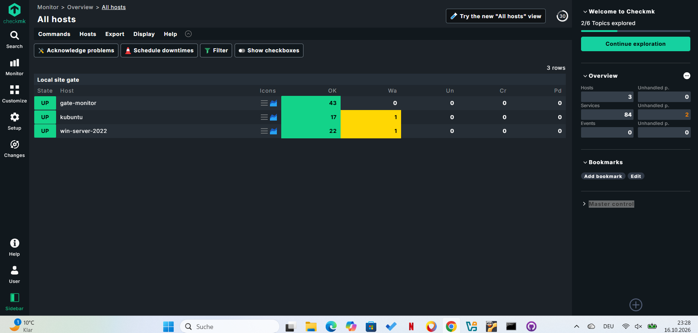
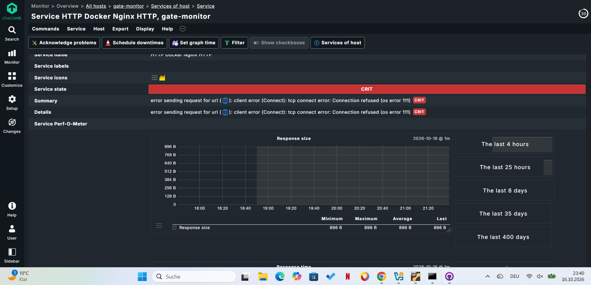
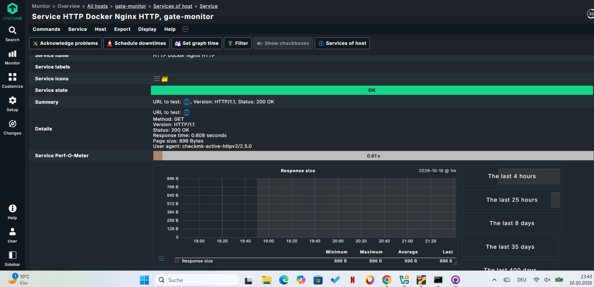

# Checkmk Docker Monitoring Lab

## Projektbeschreibung

In diesem Projekt baue ich eine Linux-basierte Monitoring-Umgebung mit Ubuntu Server, Checkmk und Docker auf.

Ziel ist es, den Zustand des Linux-Servers und seiner Docker-Container zu überwachen. Zusätzlich wird die HTTP-Erreichbarkeit eines Nginx-Webservers geprüft.

## Dokumentation

- [Installation und Konfiguration](installation.md)
- [Fehleranalyse und Troubleshooting](docs/troubleshooting.md)
- [Docker Compose-Konfiguration](docker/compose.yaml)

## Technische Umgebung

- **Betriebssystem:** Ubuntu Server 22.04.5 LTS
- **Monitoring:** Checkmk Community 2.5.0p14
- **Container-Plattform:** Docker
- **Webserver:** Nginx (`nginx:alpine`)
- **Virtualisierung:** Oracle VirtualBox
- **Netzwerk:** NAT und Host-only-Netzwerk

## Umgesetzte Funktionen

- Installation und Konfiguration von Docker
- Betrieb eines Nginx-Webservers in einem Docker-Container
- Installation des Checkmk-Agent-Plugins für Docker
- Überwachung des Docker-Daemons und der Container
- Überwachung der Speicherbelegung von Docker-Images und Containern
- HTTP-Verfügbarkeitsprüfung des Nginx-Webservers
- Überwachung von CPU, Arbeitsspeicher, Dateisystemen und Netzwerkschnittstellen

## Aktueller Projektstatus

Die grundlegende Monitoring-Umgebung ist eingerichtet.

Checkmk erkennt den Docker-Daemon und zwei Container. Der Nginx-Container läuft und die HTTP-Prüfung liefert den Status `200 OK`.

Der Container `hello-world` wurde erfolgreich ausgeführt und anschließend regulär beendet.

## Durchgeführte Tests

- Kontrollierter Ausfall des Nginx-Containers
- Erkennung des HTTP-Ausfalls durch Checkmk (`CRIT`)
- Neustart des Containers und erfolgreiche Wiederherstellung (`OK`)
- Überprüfung der HTTP-Antwort `200 OK`

## Geplante Erweiterungen

- Überprüfung der Alarmierung und Benachrichtigungen in Checkmk
- Ergänzung von Screenshots und weiteren Konfigurationsbeispielen

## Lernziele

- Linux-Serveradministration
- Docker und Containerverwaltung
- IT-Monitoring mit Checkmk
- Netzwerkdiagnose und Fehleranalyse
- Technische Dokumentation im Bereich Systemintegration
## Screenshots

### 1. Checkmk Host-Übersicht

Übersicht der überwachten Hosts und ihrer Dienste.

### 2. Nginx HTTP – OK

Checkmk prüft die Erreichbarkeit des Nginx-Webservers. Die Anfrage wird mit HTTP `200 OK` beantwortet.

### 3. Nginx HTTP – CRIT

Der Nginx-Container wurde kontrolliert gestoppt. Checkmk erkennt den Ausfall und meldet `CRIT` mit `Connection refused`.

### 4. Wiederherstellung nach dem Ausfall

Nach dem Neustart des Containers wird die HTTP-Erreichbarkeit erneut geprüft. Erwartetes Ergebnis: `OK` mit HTTP `200 OK`.

### 5. Checkmk Host-Details

Zusätzliche Ansicht des überwachten Hosts `gate-monitor`.

## Autor

Mammoomar

GitHub: [@mammoomar81-afk](https://github.com/mammoomar81-afk)

## Custom Website with Docker Compose

- Created a custom HTML website (`website/index.html`).
- Configured Nginx using Docker Compose.
- Mounted the website directory as read-only.
- Published the web server on port `8080`.
- Verified the website using `curl`.

Website URL: http://192.168.10.10:8080
